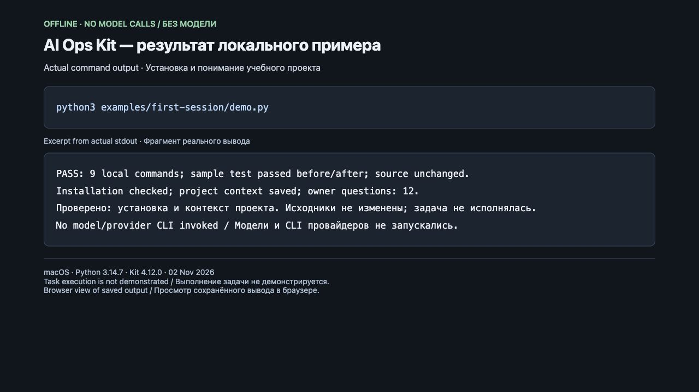

# AI Ops Kit

**[Русский](README.md) · English**

**Open your project in Codex or Claude Code and describe a task in everyday language.**
AI Ops Kit adds shared instructions, project context and checks so the next session
can continue with an understanding of the project. You get changes with check
results, or a specific reason why work could not proceed.

For founders, developers and product teams who need to know what changed,
why a decision was made and what supports the result.

## What working with it looks like

After connecting the kit and configuring an agent once, open **your product's
repository**, start a session and write, for example:

> Use AI Ops Kit. Return “Hello, friend!” for an empty name and add a test.
> Show the changes, the check result and anything remaining. Reply in English.

The agent reads project context, selects an applicable kit process, performs
authorized work and collects evidence. You do not need to choose internal roles
or edit internal plans. Credentials, permissions, product decisions and acceptance
remain yours. [What is verified and what is not is listed below](#what-is-verified-and-what-is-not).

**[Start in Codex/Claude →](docs/en/QUICKSTART.md)** — what to connect once,
what to write in your first session and how to check the result.

## What is verified and what is not

| Scenario | Status |
|---|---|
| Installation and understanding a sample project | Verified without a model: files installed and checked, Python detected, owner questions saved. [Repeat the example](examples/first-session/README.en.md) |
| Completing a task in Codex | Partially confirmed: one requirements preparation stage was checked in Codex. The full process from task to finished change is unverified. [Evidence](qualification/codex-product-stage/README.md) (Russian reference) |
| Completing a task in Claude Code | Checked with limitations: earlier runs stopped because of access; context loading and session events were checked separately later. A complete autonomous process is unverified. [Dated matrix and addendum](qualification/RUNTIME-QUALIFICATION-MATRIX-2026-10-15.md) (Russian reference) |
| Automatic connection in a new session | Experimental: off by default in the kit; a particular project may enable it explicitly. Fully unattended work in Codex and Claude Code is not yet verified. [Scope and setup](docs/agent-guides/team-session-integration.md) (Russian reference) |
| Stopping actions when a kit check fails in Codex | Codex has not demonstrated that it independently stops an agent action when a kit check fails. This is separate from reading project instructions. [Details](docs/en/QUICKSTART.md#if-the-session-did-not-pick-up-the-kit) |
| Getting started | On macOS/Linux, the new path takes 3 commands: obtain the source, prepare installation and activate the environment. Git, Python 3.12+ with venv/ensurepip and dependency access are prerequisites; agent connection is separate. The original 5-command manual path remains available. [Requirements and checked environments](docs/en/installation.md) |

[Technical connection checks and execution limitations](docs/en/QUICKSTART.md#if-the-session-did-not-pick-up-the-kit)
are documented separately. Installing files alone does not verify autonomous work.

## Try it without a model

With Git and Python 3.12+ (including `venv`/`ensurepip`), use two commands. Inspect
the retrieved repository copy before running; PyPI access is needed if the dependency is missing:

```bash
git clone https://github.com/aleksandradovgopolova-boop/ai-ops-kit.git
python3 ai-ops-kit/installer/bootstrap.py --demo --language en
```

The new entry prepares an isolated environment inside the repository copy and calls the
existing example. With dependencies already installed, the original
`python3 examples/first-session/demo.py` from the kit root still works.

The example creates a separate temporary Git project, installs the kit, checks
installation integrity, detects Python and saves a project assessment with questions
for the owner. It runs a real test before and after installation; sample sources
are preserved. It makes no model calls and does not implement the greeting change.

**[Example, actual output and environment setup →](examples/first-session/README.en.md)**



Capture of a local page showing the command's actual output, without a model.
[Recording and scope](examples/first-session/README.en.md#capture-of-an-actual-run).

## Connect your project

In Claude Code **with the AI Ops plugin already installed**, say
**“Install AI Ops”**: the skill guides installation and initial setup.
The plugin and access to an agent are separate prerequisites.

From a prepared repository copy and Python environment, installation starts with one command:

```bash
python3 installer/ai_ops.py setup /absolute/path/to/your/project
```

`setup` creates kit files, checks installation, gathers context and plan drafts,
and commits its own files to Git. It asks for owner decisions when facts are missing.
**The new setup path takes three commands**, including obtaining the source and
activating the environment; the dependency is installed automatically. The original
five-command manual path remains available. Git, Python with venv and dependency
access are required; agent configuration is separate. The new entry has local
macOS/Python 3.14 verification; CI pipeline-e2e checks Linux/Python 3.12 and 3.13
on the exact revision.
[Complete path and limitations](docs/en/installation.md).

Choose your session language: ask for Russian or English responses. These entry pages
support both languages; the entire CLI and internal documentation are not yet localized.
See [VERSION](VERSION) for the current version and [release claims](registry/release-claims.yaml)
for its channel; `qualification` does not claim `stable` status.

## Learn more

- [Quickstart](docs/en/QUICKSTART.md) · [examples](examples/README.en.md) · [glossary](docs/en/glossary.md)
- [Capabilities and limitations](docs/capability-map.md) · [full documentation](docs/index.md) (Russian references)
- [Version history](CHANGELOG.md) · [product roadmap](ROADMAP.md) (Russian references)
- [Questions and bug reports](CONTRIBUTING.en.md) · [development instructions](AGENTS.md) (Russian reference)

<details>
<summary>Technical package inventory</summary>

Command, check and role counts are derived from registries and listed in the
[capability map](docs/capability-map.md) (Russian reference). Package size does not
mean that many autonomous scenarios are verified. [Terminology](docs/en/glossary.md).

</details>

## For teams and companies

AI Ops Kit is preparing for a commercial launch. To discuss trying the kit with
your team or learn about future terms, email [sasha@rox.one](mailto:sasha@rox.one).
Current usage terms are in the [License section](#license).

## License

[PolyForm Noncommercial 1.0.0](LICENSE). The code is available to read. Personal use,
study, research and use by noncommercial organizations are free under its terms.
Commercial use (in a company, paid product or service) and resale require a commercial
license: contact the author through her [GitHub profile](https://github.com/aleksandradovgopolova-boop).

Versions published before this change, up to and including 4.12.0, remain under MIT.
