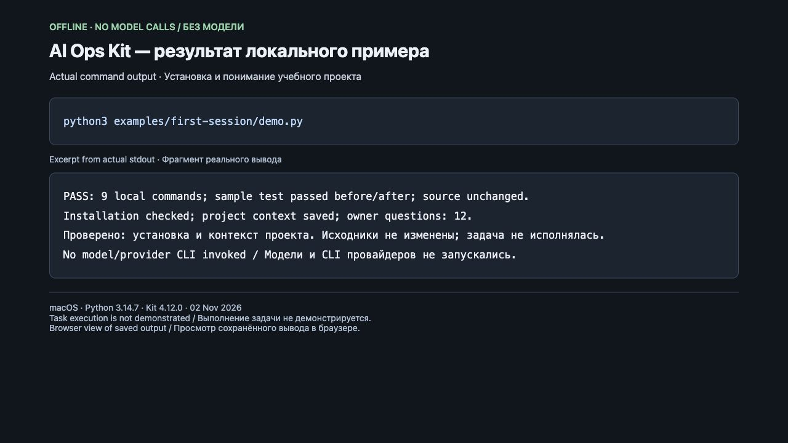

# AI Ops Kit

**Русский · [English](README.en.md)**

**Откройте проект в Codex или Claude Code и опишите задачу обычными словами.**
AI Ops Kit добавляет к проекту общие инструкции, контекст и проверки, чтобы
следующая сессия могла продолжить работу с пониманием проекта. Вы получаете
изменения вместе с результатами проверок или конкретную причину остановки.

Для основателя, разработчика или продуктовой команды, которой важно понимать:
что сделано, почему принято решение и чем подтверждён результат.

## Как выглядит работа

После разового подключения кита и настройки агента откройте **репозиторий
вашего продукта**, начните сессию и напишите, например:

> Используй AI Ops Kit. Для пустого имени верни «Hello, friend!» и добавь тест.
> Покажи изменения, результат проверки и что осталось. Отвечай по-русски.

Агент читает контекст проекта, выбирает подходящий процесс кита, выполняет
разрешённую работу и собирает подтверждения. Вам не нужно выбирать внутренние
роли и редактировать служебные планы. Токены, разрешения, продуктовые решения
и приёмка остаются за вами. [Что проверено, а что нет — ниже](#что-проверено-а-что-нет).

**[Начать в Codex/Claude →](docs/QUICKSTART.md)** — что подключить один раз,
что написать в первой сессии и как проверить результат.

## Что проверено, а что нет

| Сценарий | Состояние |
|---|---|
| Установка и знакомство с учебным проектом | Проверено без модели: файлы установлены и проверены, Python распознан, вопросы владельцу сохранены. [Повторить пример](examples/first-session/README.md) |
| Выполнение задачи в Codex | Подтверждено частично: в Codex проверен отдельный этап подготовки требований. Полный процесс от задачи до готового изменения не подтверждён. [Основание](qualification/codex-product-stage/README.md) |
| Выполнение задачи в Claude Code | Проверено с ограничениями: прежние запуски прерывались из-за доступа; позже отдельно проверены чтение контекста и события сессии. Полный автономный процесс не подтверждён. [Матрица с датами и дополнением](qualification/RUNTIME-QUALIFICATION-MATRIX-2026-10-15.md) |
| Автоматическое подключение в новой сессии | Эксперимент: в ките по умолчанию выключен, в конкретном проекте может быть включён явно. Полная работа без надзора в Codex и Claude Code ещё не подтверждена. [Границы и настройка](docs/agent-guides/team-session-integration.md) |
| Остановка действий при сбое проверки в Codex | Не подтверждено, что Codex независимо остановит действие агента при сбое проверки кита. Это отдельное ограничение от чтения проектных инструкций. [Подробности](docs/QUICKSTART.md#если-сессия-не-подхватила-кит) |
| Начало работы с чистой машины | Сейчас 5 ручных команд, затем настройка доступа к агенту. Цель «не более 3 команд» ещё не достигнута. [Полный путь](docs/guides/installation.md) |

[Технические проверки подключения и ограничения запуска](docs/QUICKSTART.md#если-сессия-не-подхватила-кит)
описаны отдельно. Установка файлов сама по себе не подтверждает автономную работу.

## Попробовать без модели

Из копии репозитория кита с Python 3.12+, Git и установленным `requirements.txt`:

```bash
python3 examples/first-session/demo.py
```

Пример создаёт отдельный временный Git-проект, устанавливает кит, проверяет
установку, определяет Python и сохраняет разбор проекта с вопросами владельцу.
Он запускает настоящий тест до и после установки; исходники примера сохраняются.
Модель не вызывается, задача по изменению приветствия не выполняется.

**[Пример, реальный вывод и подготовка среды →](examples/first-session/README.md)**



Снимок локальной страницы с реальным выводом команды, без модели.
[Запись и границы проверки](examples/first-session/README.md#снимок-реального-запуска).

## Подключить к своему проекту

В Claude Code **с уже установленным плагином AI Ops** можно написать
**«установи AI Ops»**: скилл ведёт через установку и первичную настройку.
Наличие плагина и доступ к исполнителю — отдельные предпосылки.

Из подготовленного checkout и Python-окружения установка запускается одной командой:

```bash
python3 installer/ai_ops.py setup /absolute/path/to/your/project
```

`setup` создаёт служебные файлы, проверяет установку, собирает контекст и черновики
плана и фиксирует свои файлы в Git. При нехватке сведений просит решения владельца.
[Полный путь и границы](docs/guides/installation.md).

Язык сессии выбираете вы: просите отвечать по-русски или по-английски.
Эти страницы доступны на обоих языках; весь CLI и внутренние документы пока
не локализованы. Последний выпуск — **v4.12.0 qualification**, это не обещание `stable`.

## Подробнее

- [Старт](docs/QUICKSTART.md) · [примеры](examples/README.md) · [глоссарий](docs/glossary.md)
- [Карта возможностей и ограничений](docs/capability-map.md) · [вся документация](docs/index.md)
- [История версий](CHANGELOG.md) · [план продукта](ROADMAP.md)
- [Вопросы и сообщения об ошибках](CONTRIBUTING.md) · [инструкции для разработки](AGENTS.md)

<details>
<summary>Технический состав пакета</summary>

39 <!-- claim:commands-total --> команд, 36 <!-- claim:gates-total --> проверок,
42 <!-- claim:agents-total --> роли в реестре. Это объём поставки, а не число
подтверждённых автономных сценариев. [Как читать возможности](docs/glossary.md).

</details>

## Для команд и компаний

AI Ops Kit готовится к коммерческому запуску. Чтобы обсудить возможность попробовать
кит командой или узнать будущие условия, напишите на [sasha@rox.one](mailto:sasha@rox.one).
Текущие условия использования — в [разделе «Лицензия»](#лицензия).

## Лицензия

[PolyForm Noncommercial 1.0.0](LICENSE). Код открыт для чтения. Бесплатно — для личного
использования, учёбы, исследований и некоммерческих организаций. Использование в коммерческих
целях (в компании, в платном продукте или услуге) и перепродажа — только по коммерческой
лицензии: напишите автору через [профиль на GitHub](https://github.com/aleksandradovgopolova-boop).

Версии, опубликованные до этого изменения (до 4.12.0 включительно), остаются под лицензией MIT.
