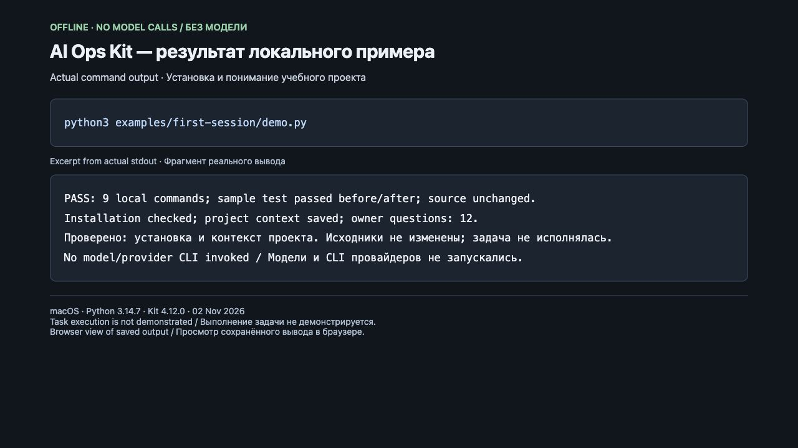

# First session: check the connection without a model

**[Русский](README.md) · English** · [All examples](../README.en.md)

One local run gives you an installed kit, an integrity check and an assessment of a
sample Python project with questions for its owner. This is real CLI output, with
no fabricated interface, model calls or pretend “task completed” result.

## Run it

You need Git, Python 3.12+ and PyYAML 6.0.3+. Without the dependency, the new
`python3 installer/bootstrap.py --demo --language en` from a checkout prepares an
isolated environment and calls this same example. It needs PyPI or a trusted local
wheel cache for the dependency. [Complete path](../../docs/en/installation.md).
From a checkout with dependencies already installed:

```bash
python3 examples/first-session/demo.py
```

The script copies [sample](sample/) into a new temporary directory and retains it for
inspection. It does not install into your real project, personal HOME/CODEX_HOME or
Git configuration. The sample commit author is set only for that Git invocation.
Kit sources are read, not installed into system Python. The script does not launch
Codex, Claude, other provider CLIs or OpenSpec.

## What happens and where the result goes

| Step | Actual result |
|---|---|
| Create the sample Git repository | Initial commit with four sample files |
| Run `unittest` | Verifies `greet("Ada") == "Hello, Ada!"` |
| `installer/ai_ops.py init` | Installs `.ai/managed/`, `.ai-ops.yaml`, `ai-ops` and project instructions |
| `./ai-ops doctor` | Checks delivered files and their integrity |
| `./ai-ops onboard` | Detects Python from `pyproject.toml` |
| `./ai-ops model --json` | Saves project understanding; unknown facts become owner questions |
| Check sources and rerun the test | All four original files are unchanged; the test passes again |

The `Sample and actual outputs` path contains `greeting-sample/` and `evidence/`.
`evidence/` contains exact stdout/stderr for each step, commands and exit codes in
`commands.json`, the project JSON in `08-model.stdout.txt`, and `summary.json`.
A nonzero command exit stops the example. Original files and Python detection are
checked separately from CLI messages.

[Recorded summary from an actual run](recorded-summary.json) ·
[actual doctor output](recorded-doctor.txt) · [actual test output](recorded-test.txt).
Recording context: 2026-11-02, macOS, Python 3.14.7, kit 4.12.0, base `146e0c3f`.
Question/file counts can change by version; this recording does not promise future
output. CLI output here is partly in Russian even for an English-speaking team.

## Capture of an actual run



2026-11-02, macOS, Python 3.14.7, Kit 4.12.0, base `3a3ee8ec`: the command
`python3 examples/first-session/demo.py` exited with code 0. All 9 commands passed,
the test ran before and after installation, sources were preserved; owner questions: 12.

This is a browser capture of a [local viewer](capture/output.html) of saved output,
not a product interface or an autonomous AI session. The capture was visually
inspected; result text was not drawn. In [stdout](capture/stdout.txt), only the
temporary directory path is replaced with `<temporary-demo-directory>`; the capture
omits the path lines. [stderr](capture/stderr.txt) is empty.

[Recording context](capture/capture-context.json) · [summary](capture/summary.json) ·
[installation check](capture/06-doctor.stdout.txt) · [repeated test](capture/09-sample-test-after.stderr.txt).
No model or provider CLI was launched. The greeting change and a complete autonomous
process were not tested in this recording. To recapture, rerun the example, view its
actual output and update the recording context along with the image.

## Next task in Codex/Claude

Open `greeting-sample/` at the printed path and use the
[quickstart instruction](../../docs/en/QUICKSTART.md), for example:

> Return “Hello, friend!” for an empty name and add a test. Reply in English.

This is **a next step, not executed by the demo**: it needs an available executor,
access configuration and an agreed budget. The example does not prove hook autostart,
model answer quality, independent review, CI or native adapter readiness. It leaves
installation files uncommitted for inspection; review and commit them before a live
task. Live execution needs separate verification.

## If it fails

Missing `yaml`: activate the environment with `requirements.txt` installed. Missing
Git or a supported Python: install them before running. For another failure, preserve
the printed directory and the last step's logs; a rerun creates an independent sample.
You can delete the old directory after inspection when it is no longer needed.
The example needs no secrets or API keys.
