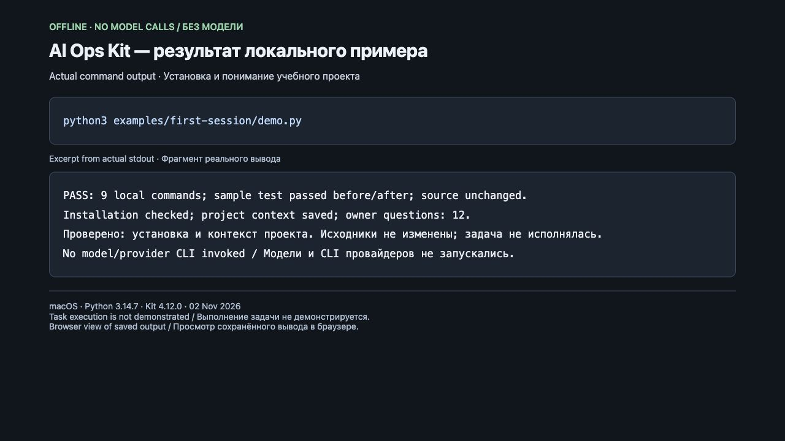

# Первая сессия: проверить подключение без модели

**Русский · [English](README.en.md)** · [Все примеры](../README.md)

За один локальный запуск вы получите установленный кит, проверку его целостности
и разбор учебного Python-проекта с вопросами владельцу. Это реальный вывод CLI,
без нарисованного интерфейса, вызовов модели и притворного «задача выполнена».

## Запустить

Нужны Git, Python 3.12+ и PyYAML 6.0.3+. Без готовой зависимости новый
`python3 installer/bootstrap.py --demo` из checkout подготовит отдельное окружение
и вызовет этот же пример; для получения зависимости нужен PyPI либо доверенный
локальный кеш wheel. [Полный путь](../../docs/guides/installation.md).
Из корня checkout с уже готовыми зависимостями:

```bash
python3 examples/first-session/demo.py
```

Скрипт копирует [sample](sample/) в новый временный каталог и оставляет его для
просмотра. Настоящий проект, пользовательские HOME/CODEX_HOME и Git-конфигурация
не используются как место установки. Автор sample-коммита задаётся только в вызове
Git. Исходники кита читаются, а не устанавливаются в системный Python.
Скрипт не запускает Codex, Claude, другие CLI провайдеров или OpenSpec.

## Что происходит и где результат

| Шаг | Действительный результат |
|---|---|
| Создать sample Git-репозиторий | Первый коммит с четырьмя учебными файлами |
| Запустить `unittest` | Проверено `greet("Ada") == "Hello, Ada!"` |
| `installer/ai_ops.py init` | Установлены `.ai/managed/`, `.ai-ops.yaml`, `ai-ops` и проектные инструкции |
| `./ai-ops doctor` | Проверены доставленные файлы и их целостность |
| `./ai-ops onboard` | Python определён по `pyproject.toml` |
| `./ai-ops model --json` | Сохранено понимание проекта; неизвестные факты стали вопросами владельцу |
| Проверить исходники и повторить тест | Четыре исходных файла не изменились; тест снова прошёл |

Путь `Sample and actual outputs` в выводе содержит `greeting-sample/` и `evidence/`.
В `evidence/` лежат точные stdout/stderr каждого шага, команды и коды возврата
в `commands.json`, JSON-разбор проекта в `08-model.stdout.txt` и итог `summary.json`.
Ненулевой код команды останавливает пример. Проверка исходных файлов и распознанного
Python выполняется отдельно от сообщений CLI.

[Записанный итог реального прогона](recorded-summary.json) ·
[реальный вывод doctor](recorded-doctor.txt) · [реальный вывод теста](recorded-test.txt).
Контекст записи: 02.11.2026, macOS, Python 3.14.7, kit 4.12.0, база `146e0c3f`.
Число вопросов и файлов может меняться с версией; запись не обещает будущий вывод.
CLI здесь частично русскоязычный, даже если сессия команды англоязычная.

## Снимок реального запуска



02.11.2026, macOS, Python 3.14.7, Kit 4.12.0, база `3a3ee8ec`: команда
`python3 examples/first-session/demo.py` завершилась с кодом 0. Все 9 команд
прошли, тест выполнен до и после установки, исходники сохранены; вопросов владельцу — 12.

Это снимок [локальной страницы просмотра](capture/output.html) сохранённого вывода,
а не интерфейс продукта или автономная AI-сессия. Снимок снят браузером и проверен
визуально; текст результата не рисовался. В [stdout](capture/stdout.txt) только путь
временной папки заменён на `<temporary-demo-directory>`; на снимке строки с путями
опущены. [stderr](capture/stderr.txt) пустой.

[Контекст записи](capture/capture-context.json) · [итог](capture/summary.json) ·
[проверка установки](capture/06-doctor.stdout.txt) · [повторный тест](capture/09-sample-test-after.stderr.txt).
Модели и CLI провайдеров не запускались. Изменение приветствия и полный автономный
процесс этой записью не проверены. Для повторного снимка запустите пример заново,
откройте его фактический вывод и обновите контекст записи вместе с изображением.

## Следующая задача в Codex/Claude

Откройте `greeting-sample/` из показанного пути и используйте инструкцию из
[короткого старта](../../docs/QUICKSTART.md), например:

> Для пустого имени верни «Hello, friend!» и добавь тест. Отвечай по-русски.

Это **следующий, не выполненный демо шаг**: потребуются доступный исполнитель,
настройка доступа и согласованный бюджет. Пример не доказывает автозапуск hooks,
качество ответа модели, независимое ревью, CI или готовность native adapter.
Он оставляет файлы установки незакоммиченными для осмотра; до живой задачи
проверьте и закоммитьте их. Проверять live-исполнение следует отдельно.

## Если не получилось

Нет `yaml` — активируйте окружение с `requirements.txt`. Нет Git/Python нужной
версии — установите их до запуска. Другой сбой — сохраните показанный путь и журнал
последнего шага; повтор создаёт новый независимый sample. Старую папку можно удалить
после просмотра, когда она больше не нужна. Секреты и API-ключи примеру не нужны.
