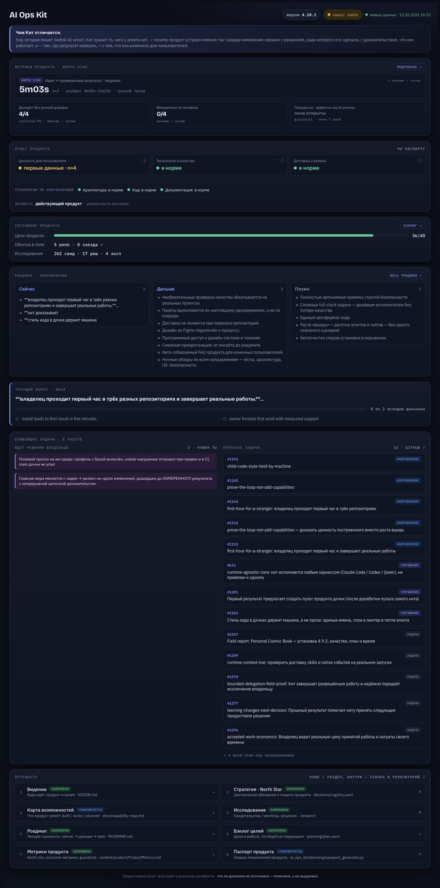
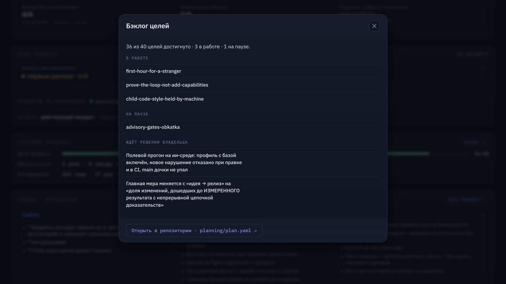
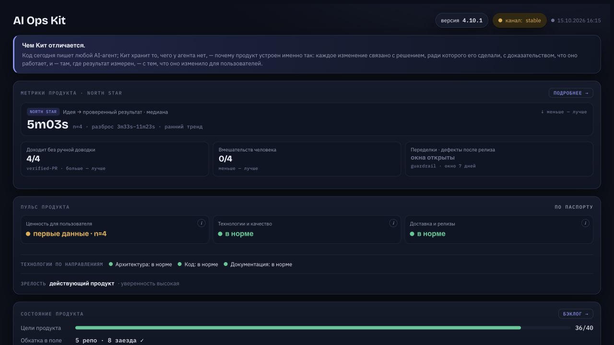

# #1240 — проверка существующего пульта по пяти вопросам

15.10.2026, AI / Codex, Product Design Audit, in-app browser 1280×720.
Проверена неизменённая страница dashboard/index.html из Kit main 9cab0d43 с
актуальным data.json, собранным штатной build() в отдельный временный каталог.
Основной checkout, прод и опубликованный сайт не менялись. Это проверка экрана,
не новая панель, не owner-led приёмка и не бизнес-эффект.

## 1. Текущий пульт — частично помогает

Цель: понять где продукт, зачем следующий шаг, что мешает, что изменилось,
что делать дальше. Версия/дата/цели и происхождение метрик видны; n=4 и открытые
окна guardrail названы. Но список issues не ранжирован как одна рекомендация,
а отдельного ответа «что изменилось» нет. Веха и исходы частично показывают
внутренние идентификаторы и Markdown-маркеры. Блокер показан названием, без
сохранённых waiting_on/human_decision и ссылки на доказательство отказа.

## 2. Бэклог — открывается, но не выбирает работу

Кнопка открыла модальное окно, закрытие вернуло фокус на кнопку бэклога.
Есть источник planning/plan.yaml; вместо конкретного следующего действия
показаны три id направлений и два названия ожидающих работ. Это навигация к
источнику, а не рекомендация. Полная клавиатурная/экранная доступность не
квалифицирована; из screenshots соответствие WCAG не выводится.

## 3. Нет свежего data.json — деградация недостаточно объяснена

В отдельной копии data.json временно переименован, страница перезагружена.
Встроенный снимок сохранил содержимое; «живые данные» исчезли, но вместо них
осталась лишь дата и серый индикатор. Явного сообщения «снимок / свежие данные
недоступны» нет. Файл восстановлен после проверки. Первый screenshot этого шага
был снят с прокрученной страницей и отклонён; сохранённый файл показывает шапку.

## Приоритет и конкретный brief до реализации

1. P1: использовать существующий delivery_plan.resolve для одной следующей работы:
   название, почему, что разблокирует, источник; не более двух альтернатив.
   Отсутствующий/некорректный план — unknown/degraded, не выдуманная рекомендация.
2. P1: различать блокер доступа, деловой выбор и готовую автономную работу.
   Показывать существующие waiting_on/human_decision/evidence, не добавлять второй план.
3. P1: явная подпись live/snapshot/unavailable с датой и источником; при fallback
   не заявлять актуальность или возможность начать без проверки.
4. P2: «что изменилось» из реальных последних commit/evidence; отсутствие данных
   назвать unknown. Счёт файлов не доказывает полезный продуктовый эффект.
5. P2: нормализовать читаемые заголовки и убрать Markdown/id из основной строки;
   исходные пути остаются в деталях. Визуальный стиль сохраняется.

## Три приёмочных сценария следующего изменения

| Сценарий | Ожидаемый ответ | Доказательство |
|---|---|---|
| Валидный план и доступная работа | Одна основная рекомендация, ≤2 альтернатив, причина и source | Совпадает с существующим resolve(), не ручным списком |
| Работы ждут доступа/решения | Существующая причина и разрешённый следующий шаг; AI не принимает решение за владельца | waiting_on/human_decision/evidence сохранены |
| План/свежие данные недоступны | Явный unknown/degraded/snapshot, дата; нет вымышленной следующей работы | Отказ чтения/fetch и отсутствие источника проверены |

Текущий экран эти сценарии полностью не проходит. Этот файл — результат проверки
и brief до реализации, не заявление готового нового поведения и не разрешение
дублировать dashboard в дочках раньше доработки (#1201).

Источники: dashboard/index.html, dashboard/build_data.py, planning/plan.yaml,
ai_ops_kit/planning/delivery_plan.py; все три screenshot сняты в этой проверке,
сохранённые файлы повторно открыты и осмотрены. Полный аудит доступности,
телефонный экран и независимая owner-led приёмка не выполнялись.

Capture data SHA256: `8daf602e3c6972bdc58b29ac0c1e9b99b1f7d221d95b2aae794ed7c1b4b478a5`.
Снимок данных сохранён в output текущей сессии; GitHub issues со временем меняются.
