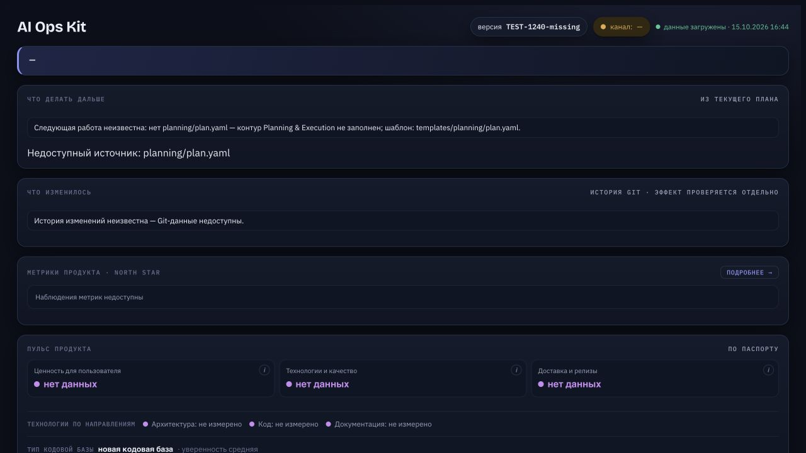
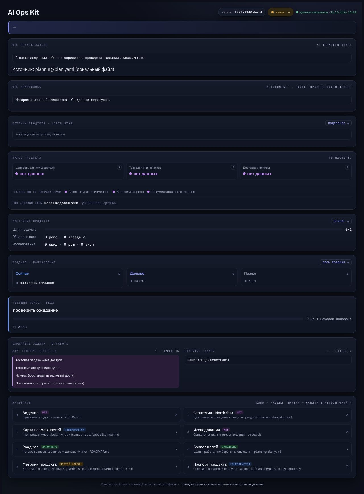
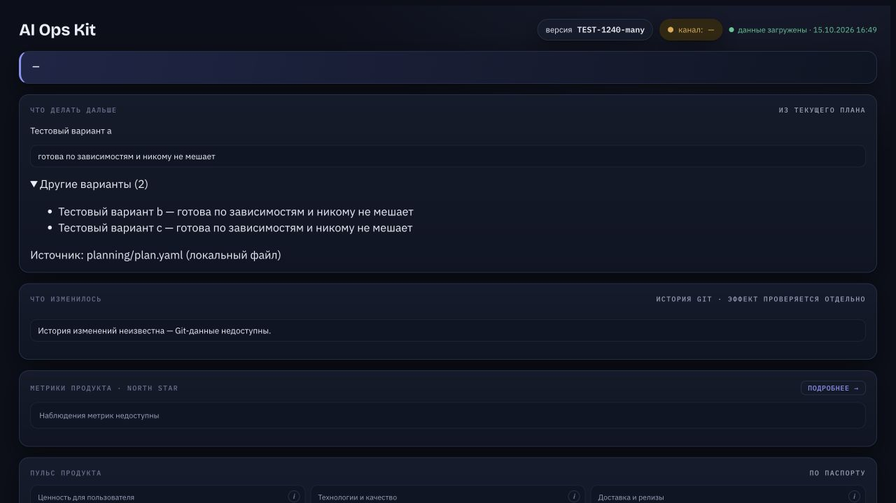
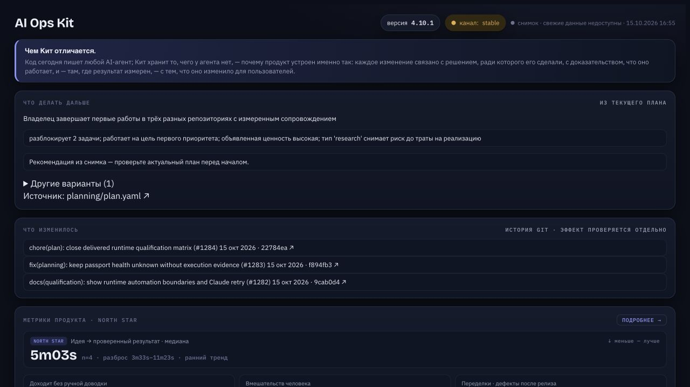

# Проверка существующего пульта — 15 октября 2026

Исполнитель: AI (Codex). Это проверка реализации #1240, не приёмка владельцем,
не новая работа дочернего продукта и не наблюдение полевой когорты #1243.
Исходный аудит и brief: [предыдущий отчёт](../product-view-audit-2026-10-15/README.md).
Вердикт по проверенным сценариям: интерфейс отвечает на пять вопросов существующими
источниками; неизвестное и ожидание не превращаются в готовую работу.

## 1. Где продукт и зачем

Сохранены источники паспорта, целей и роадмапа. Классификация NEW/EXISTING названа
типом кодовой базы, а не продуктовой зрелостью. Наличие файлов CI/тестов не выдаётся
за пройденные проверки. Отсутствующая база модульных размеров — «не измерено».

## 2. Что мешает и что дальше

Временные изолированные репозитории missing/held/many используют настоящий next_work,
а не вручную нарисованный ответ. Источник данных строит dashboard/build_data.py.
- missing: отсутствует план → следующая работа неизвестна; чужие метрики снимка
  очищены, unavailable не превращается в ноль открытых GitHub issues.
- held: есть корректный план, но все работы ждут → нет выдуманной готовой задачи;
  показаны waiting_on, human_decision и evidence; локальный источник не становится
  фиктивной GitHub-ссылкой.
- many: четыре готовых входа → одна рекомендация a, раскрываются только b и c;
  четвёртый вариант не показан. Порядок берётся из существующего next_work.

## 3. Что изменилось и насколько свеж источник

На настоящем дереве Кита показаны три последних Git-коммита (22784ea, f894fb3,
9cab0d4); техническая история явно отделена от измеренного продуктового эффекта.
При недоступном data.json остаётся встроенный снимок, заголовок прямо сообщает
«свежие данные недоступны», а рекомендация требует проверить текущий план.
Это отказ чтения файла на локальном сервере, без вмешательства в production.
Загруженный JSON называется «данные загружены», не гарантированно живыми данными.

Проверка выполнена в настоящем браузере Codex IAB при 1280×720; held сохранён
полной страницей. Снимки missing/held/many помечены TEST-1240 и не считаются
пользовательскими результатами. Проверен также inline JSON со строкой закрытия
script: значение сохраняется, новый исполняемый скрипт не создаётся.

Точечные проверки: 17 passed (11 новых + 6 существующих). Финальная полная
проверка и GitHub CI указываются в PR, с точным охватом full-current-python.
Машинные data.json/встроенный snapshot обновляются отдельным небольшим PR:
код безопасно читает старый формат; публикация Pages строит данные заново.

Финальная проверка исходников: **9055 passed, 35 skipped, 2 warnings**, 1771.82 s,
CPython 3.14.7 / darwin, full-current-python, exit0. Это не compatibility-matrix.
Длительность включает конкуренцию за ресурсы с другим полным прогоном; сравнения
скорости продукта по этому времени не делаются.
